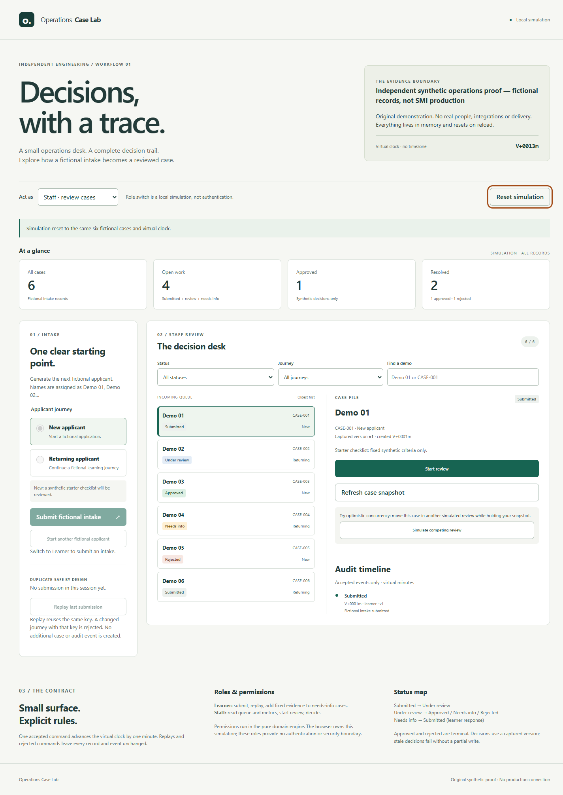

# SMI Digital Operations — Institutional Case Study

Superior Multiskills Institution (SMI) operates across eight institutional domains, with a separately documented 12-item application and module inventory spanning institutional access, learner platforms, academic services, registration, scholarship administration and learner engagement.

> Public institutional case study **plus a separate, original synthetic workflow demo**. The demo is not production SMI source or a live Registration Hub. No real student/staff records, database exports, credentials, internal routes or administrative access details are published.

## Digital application inventory

The institutional inventory contains **12 named applications and modules**, grouped by their role:

### Institutional access and learner services
- **SMI Main Website** — public institutional entry point.
- **Scholarships Portal** — public scholarship information and access.
- **Course Subscription** — learner-facing course subscription and enrollment.
- **SCI Appointment System** — appointment coordination.

### Learning and assessment
- **Secondary Training Platform** — learner access to SMI's secondary training periods.
- **Student Gateway · Core Periods** — the student entry point for core-period learning and academic activity.
- **Student Examinations** — an examination module inside Student Gateway, not a separate application.

### Registration, administration and engagement
- **Registration Hub** — unified registration workflow; current release state and route remain unverified.
- **Registration Control Center** — staff-facing registration review and administrative control.
- **Scholarship Control Center** — staff-facing scholarship administration.
- **CRM · Leads** — internal lead records and follow-up.
- **Outreach** — an engagement workflow embedded in Secondary Training.

See the [eight-domain operating model](docs/OPERATING-MODEL.md), detailed [system inventory](docs/SYSTEM-INVENTORY.md) and [operating architecture](docs/ARCHITECTURE.md).

For technical-project and product-management assessment, see the [Product & Delivery Evidence Packet](docs/PRODUCT-DELIVERY-EVIDENCE.md), which distinguishes verified inventory facts, proposed acceptance criteria, missing measurement evidence and privacy constraints. The [SMI institutional portfolio record](https://ahmed-gamil-portfolio.ahmedabdulbarim.workers.dev/smi#digital-systems), [digital platform case study](https://ahmed-gamil-portfolio.ahmedabdulbarim.workers.dev/case-studies/smi-digital-learning-platform) and [Registration Hub case study](https://ahmed-gamil-portfolio.ahmedabdulbarim.workers.dev/case-studies/smi-registration-hub) present the related portfolio records.

## Independent runnable engineering proof

The [Operations Case Lab](demo/operations-case-lab/README.md) is an original, **runnable local-only simulation** with new/returning fictional applications, a staff decision queue, optimistic-version conflict handling, idempotent replay, in-memory audit history and synthetic metrics. It is not SMI's real Registration Hub, authentication service or database.

**Verified evidence (21 November 2026):** 39/39 automated Node tests passed, 38 automated Chrome assertions passed across 1440px and 390px viewports, and the [main-branch GitHub Actions run succeeded](https://github.com/a7medgamil/smi-digital-operations-showcase/actions/runs/44895321053) on the published demo. Review the [QA report](demo/operations-case-lab/QA_REPORT.md), [machine-readable browser results](demo/operations-case-lab/qa-artifacts/browser-results.json), [desktop screenshot](demo/operations-case-lab/qa-artifacts/operations-1440.png), [mobile screenshot](demo/operations-case-lab/qa-artifacts/operations-390.png) and [engineering boundary and decisions](docs/INDEPENDENT-OPERATIONS-ENGINEERING.md).

*The tests prove this independent sample's behavior under the listed conditions, not SMI production performance, privacy certification or deployment.*

## Public route reachability

The following public routes returned **HTTP 200** in a route-level check on **15 November 2026**:

- [SMI Main Website](https://smi-platform.org/)
- [Secondary Training](https://smi-platform.org/smi-secondary-training/)
- [Student Gateway](https://smi-platform.org/student-gateway/)
- [Scholarships](https://smi-platform.org/scholarships/)
- [Course Subscription](https://smi-platform.org/course-subscribe/)
- [SCI Appointments](https://smi-platform.org/appointments/)

HTTP 200 confirms that a route responded at the time of the check. It does **not** certify end-to-end workflow correctness, integrations, authentication rules, data consistency or production readiness.

## MIYTO Smart Rooms

MIYTO supports paired, level-aware audio practice and structured speaking sessions. Its product and engineering record is maintained separately in the public [MIYTO Smart Rooms showcase](https://github.com/a7medgamil/miyto-smart-rooms-showcase).

## Governance and privacy

- Public routes are listed; staff-only administrative URLs are deliberately withheld.
- Learner, staff, applicant and scholarship records remain private.
- Internal source code, database schemas, credentials and infrastructure details are not included.
- Examinations and Outreach are identified as embedded modules, not separate deployments.
- Inventory presence is not treated as proof of release or functional acceptance.
- The architecture diagram groups service responsibilities; it is not a verified data-flow or shared-database diagram.

## Evidence boundary

The route check is a reachability observation. Module-level test reports, approved interface captures and anonymized operational evidence must be reviewed separately before stronger implementation or outcome claims are made.

© 2026 Superior Multiskills Institution. All rights reserved.
