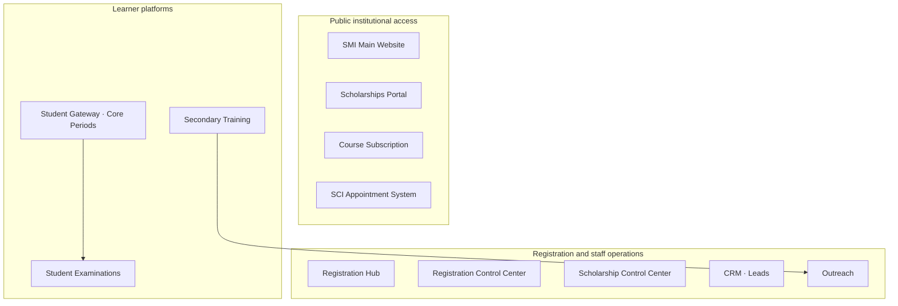

# SMI Digital Operations — Service Architecture

## Reading the diagram

- The three groups distinguish public entry points, learner-facing platforms and staff-facing operations.
- Examinations are a module inside Student Gateway.
- Outreach is embedded within Secondary Training.
- The diagram does **not** assert that all other services share a database, exchange records automatically or are connected through a single API.
- Staff-only routes are intentionally omitted.

This is a service-responsibility map, not a technical deployment diagram or a verified data-flow model.
