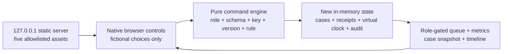

# Independent operations engineering proof

The [Operations Case Lab](../demo/operations-case-lab/README.md) is original synthetic application code added alongside the institutional inventory. It demonstrates a small executable workflow contract: intake, duplicate handling, permission checks, staff decisions, concurrency conflicts and a traceable audit. It is not the live Registration Hub, a replica of an SMI application, or evidence of real SMI registration outcomes.

The existing 12-item inventory, eight-domain operating model and dated public-route reachability evidence retain their original scope. This proof supplies no new production verification. It uses no real records, private implementations, databases, operational endpoints or SMI infrastructure.

## Architecture

The static server has no write endpoints. Browser ES modules own one disposable state value. The pure engine does not read time, generate randomness, access the DOM or perform I/O. A command either returns a new state with the complete accepted event or returns the identical input state on failure. Prior state is never mutated; tests freeze nested input to verify this.

The engine state is trusted, created by its own constructors and transitions. It does not validate arbitrary imported state. The UI renders only engine-generated values and fixed enumeration labels; search input is used for comparison and never interpolated into HTML. There is no free-text record ingestion.

## Decisions and trade-offs

| Decision | Demonstrated property | Deliberate limit |
|---|---|---|
| Pure ES-module engine, no dependencies | Rules run identically in browser and Node tests | No framework/toolchain scalability claim |
| New and Returning journey enum | Product journey choice remains visible through queue/detail | No identity lookup; both use the same review lifecycle |
| In-memory receipt per intake key | Same key/payload replays; changed payload conflicts | Keys survive only this run; no durable idempotency store |
| Explicit next-draft action | Repeated Submit clicks reuse a key | A new generated applicant requires a separate action |
| Integer compare-and-swap version | Stale decisions fail before any accepted state/audit write | A sequential competing-review exercise, not distributed contention |
| Virtual elapsed-minute clock | Exact reproducible timestamps, independent engine instances | No real timezone, session, timer or SLA measurement |
| Fixed roles in domain commands and queries | Hidden controls cannot bypass rule checks through the normal engine | Browser role selection provides no authentication, ownership or security isolation |
| Enumerated reasons and generated names | Decision explanations without contact data or uncontrolled notes | No actual evidence attachments, review criteria or personal records |
| One event per accepted mutation | Audit, versions and state stay coherent | Failures are notices; no durable rejected-attempt log |
| Metrics derived from current records | Exact totals and status counts, independent of active queue filters | No real operational analytics or performance claim |
| Exact-path loopback server | Only five assets; no source/docs/dotfile access; restrictive headers | Local demonstration host, not a production application server |

## Workflow contract

| Current status | Actor | Allowed next status | Fixed reason |
|---|---|---|---|
| Submitted | Staff | Under review | Review started |
| Under review | Staff | Approved | Synthetic checklist complete |
| Under review | Staff | Needs info | Synthetic evidence missing |
| Under review | Staff | Rejected | Synthetic criteria not met |
| Needs info | Learner | Submitted | Synthetic evidence added |
| Approved / Rejected | Neither | None | Terminal |

Only Learner may submit/replay intake. Only Staff may query the queue/aggregate metrics. A known role, exact command fields, synthetic values, valid key or record, integer expected version, allowed transition, authorized role and matching reason are required as applicable. Unknown fields, invalid/unauthorized changes and conflicts preserve the entire input state. For transitions, the version comparison precedes transition/rule validation so a held stale snapshot is reported consistently as a conflict. These error messages are educational, not a production authorization disclosure policy.

The idempotency key is unique across the disposable run. Its fingerprint is the only accepted intake payload field, `journey`; there are no applicant identity/contact fields. Replaying a closed case returns its original ID without reopening it. Accepted intake starts version 1; each accepted transition increments its version once. Every accepted mutation increments the global virtual minute and appends a sequenced event. Duplicate replay, filter changes, rejected actions and role changes do not advance time.

## Why synthetic state is useful evidence

An executable state machine lets a reviewer test decisions and invariants: an approval must follow review; a learner cannot approve by invoking the engine; a stale decision cannot overwrite an accepted decision; a retry cannot inflate metrics; a needs-info response must re-enter review. Exact fixtures make these claims reproducible without access to real people or systems. The scope is deliberately small enough for a reviewer to read the implementation and repeat its checks.

This is engineering evidence for evaluating requirements, operational decisions and full-stack boundaries. It does not establish production adoption, actual institutional permissions, privacy certification or verified student outcomes. The [QA report](../demo/operations-case-lab/QA_REPORT.md) distinguishes executed local tests, browser automation, limitations and pending CI.

## Separation from the editorial workstream

The pre-existing ChatGPT Product/Delivery evidence branch `docs/remote-career-evidence-20261121` and draft PR #1 are a separate workstream. This task neither reads nor edits that branch/PR, imports its content, nor merges it. The only change to existing institutional prose is the root README's concise link to this independent runnable proof. Existing inventory, domains and historical routes remain intact. This document explains the new synthetic engineering implementation; it does not duplicate the editorial career narrative.

No commit, push, PR or deployment is part of this delivery. A separate reviewer must inspect the uncommitted diff, repeat checks, and evaluate any later GitHub Actions run on its actual proposed SHA.
